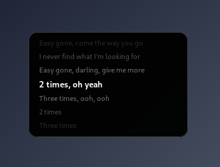
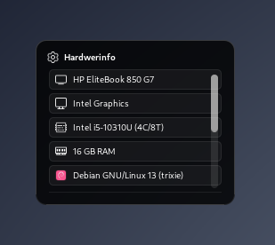
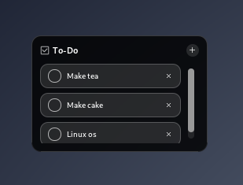
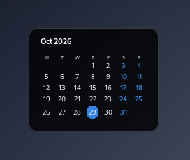
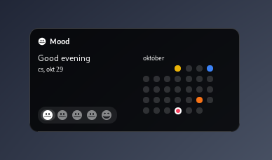

# Grid Desktop

A high-performance desktop widget ecosystem and icon manager for GNOME Shell, powered by a screen-adaptive canvas grid and pure Clutter rendering.

### Core Architecture & Highlights

- **Dynamic Grid Scaling**: Automatically adapts cell sizing and layout to any display resolution and aspect ratio — full native support for standard 16:9 displays and Ultrawide (21:9 / 32:9) monitors.
- **Smart Multi-Monitor Support**: Cleanly handles display topology changes (docking, undocking, laptop lid open/close) across Wayland and X11 sessions, with per-widget monitor pinning (e.g. pinned to Primary Monitor or Follow Global).
- **Precision Alignment & Grid Overlay**: Snap-to-grid placement with dynamic collision avoidance and interactive resizing across up to 3 widget sizes. Includes a toggleable on-screen grid overlay to make layout designing effortless.
- **Pure Clutter Engine**: High-performance, lightweight rendering directly via Clutter without external CSS dependencies, built for GNOME 48, 49, 50, and 51.
- **Integrated Desktop Icon Manager & Context Actions**:
  - Native desktop icon support snapped cleanly to the adaptive grid with customizable alignment (Left / Right) and sort orientation (Vertical / Horizontal)
  - Native desktop context menu with **Paste to Desktop** functionality for file clipboard transfers
  - Toggle icon labels, auto-layout reorganization, and quick shortcuts for Home folder, Trash, and mounted/network drives
- **Modernized Libadwaita Preferences**:
  - Fully overhauled settings window utilizing native `Adw.PreferencesRow` and `Adw.ActionRow` lists rather than card layouts
  - Streamlined appearance controls: unified system theming, Adwaita light/dark support, and curated color palettes without redundant styling overrides where they don't belong
  - Global preferences and selective per-widget styling (background color, 0–100% opacity slider, custom typography)
- **Dedicated Insights & Data Export**: Built-in tracking hub with detailed day-by-day breakdowns for active Screen Time and Mood trends, featuring one-click JSON data export.

---

### Widgets & Customization Options

#### Media & Imagery
*Dynamic desktop media playback controls, turntable animations, and visual display tiles.*

| Music Player (Wide) | Music Player (Vinyl Turntable) |
| :---: | :---: | :---: |
|  |  |  |

- **Music Player**: Compact media player featuring album artwork, track details, and playback controls. Features a vintage vinyl turntable view with an animated tonearm synchronized to track playback and seeking, alongside a real-time fluid audio spectrum visualizer (CAVA / 16-Bar Equalizer).
- **Music Player (Wide)**: Expanded horizontal layout displaying album artwork alongside track info, artist details, and playback controls. Automatically adapts its background accent to match the active album artwork palette.
- **Image / GIF**: Displays static images or animated GIFs directly on the desktop grid, with support for custom image captions.
- **Image Slideshow**: Cycles smoothly through local images from a selected folder using crossfade transitions, with support for captions.
- **Lyrics**: Synchronized real-time song lyrics for currently playing media.
---

#### Weather & Sun
*Comprehensive Open-Meteo powered weather tracking with dynamic visuals and modular metrics.*

| Weather Forecast & Standard Views | Moon & Solar Schedule |
| :---: | :---: |
|  |  |

| Weather Modular Glance Cards |
| :---: |
|  |

- **Weather Standard / Minimal / Forecast**: Comprehensive current weather and extended multi-day forecasts with live atmospheric overlay backgrounds and dynamic temperature bars.
- **Solar Schedule & Moon**: Real-time daylight progression curve, sunrise/sunset times, and lunar illumination phase tracking.
- **Weather Cards**: Standalone glance cards for UV Index, Humidity, AQI, Wind Speed, Pressure, Feels Like, Wind Gusts, Dew Point, and Cloud Cover with sparkline trend charts.

---

#### System Monitor & Hardware
*Comprehensive hardware telemetry, package tracking, and desktop power utilities.*

| Hardware Info | System Monitor |
| :---: | :---: |
|  |  |

| System Controls & Quick Toggles | System Telemetry & Compact Metrics |
| :---: | :---: |
|  |  |

| System Info Cards | Resource Wheel | Storage Bar |
| :---: | :---: | :---: |
|  |  |  |

| Battery Status | Bluetooth Devices |
| :---: | :---: |
|  |  |

- **Hardware Info**: Complete system and hardware overview displaying CPU model, GPU architecture, total RAM, motherboard, and OS distribution details.
- **System Uptime & Updates**: Real-time system boot uptime tracking and pending package updates count (APT, DNF, Pacman, Flatpak).
- **System Dashboard & Monitor**: Comprehensive side-by-side graphs for CPU, RAM, disk throughput, and thermal metrics.
- **Storage Bar & Resource Wheel**: Circular telemetry and multi-category disk breakdown across system partitions.
- **Desktop Controls & Power**: Dedicated sliders for volume and display brightness, power mode profiles (Balanced, Performance, Saver), audio sink toggles, and session controls.

---

#### Productivity, Files & Organization
*Desktop workflow, task management, file quick-look, and productivity enhancement tools.*

| Folder Preview | Tasks & Checklists |
| :---: | :---: |
|  |  |

| Pomodoro Focus | Pomodoro Timer |
| :---: | :---: |
|  |  |

| App Launcher, Mail & Clipboard | Quick Notes |
| :---: | :---: |
|  |  |

- **Folder Preview**: Interactive desktop directory viewer for quick desktop file browsing and direct launching.
- **Pomodoro Timer & Focus**: Circular countdown tracker and compact horizontal focus modes with cycle completion stats.
- **Tasks & Quick Notes**: Inline markdown sticky scratchpads and to-do lists with checkbox completion.
- **Clipboard History, Mail & App Launcher**: Fast clipboard snippet reuse, unread email counter across GNOME Online Accounts, and a compact application launcher dock.

---

#### Time & Calendar
*Precision desktop timekeeping, global clocks, countdowns, and schedule trackers.*

| Analog Clock Skins | World Analog Clock |
| :---: | :---: |
|  |  |

| Time & Date (Digital) | World Clock | Binary Time |
| :---: | :---: | :---: |
|  |  |  |

| Calendar (Day View) | Month Calendar | Calendar Tasks |
| :---: | :---: | :---: |
|  |  |  |

| Timer | Countdown | Stopwatch |
| :---: | :---: | :---: |
|  |  |  |

- **Analog Clock Skins**: Multiple built-in faces (Basic, Rolex, Sensa) with smooth sweeping second hand and floating canvas mode.
- **World Clocks**: Multi-timezone digital and quad-analog dial displays.
- **Calendars & Agenda**: Standalone day calendar, compact month grid, and aggregated daily calendar tasks.
- **Time Tracking Tools**: Standard countdown gauges, stopwatch counters, and BCD binary clock rendering.

---

#### Personal, Wellness & Tracking
*Habit formation, market tracking, daily wellness, and informational feeds.*

| Currency Tracker | Crypto Tracker |
| :---: | :---: |
|  |  |

| GitHub Activity | Watermind Hydration |
| :---: | :---: |
|  |  |

| Habit Tracker | Screen Time Monitor | Mood Logger |
| :---: | :---: | :---: |
|  |  |  |

| Today in History | Daily Quotes | RSS Headlines | LavaLamp |
| :---: | :---: | :---: | :---: |
|  |  |  |  |

- **Market Trackers**: Real-time fiat exchange rates (Frankfurter API) and cryptocurrency charts (CoinGecko API) with 24h/30d trend lines.
- **Wellness & Habits**: Smart 8-hour hydration tracker (Watermind), daily streaks logger, and emotional mood trends.
- **Activity & Feeds**: GitHub contribution heat map, active screen time analytics, daily historical milestones, news reader, and ambient decorative LavaLamp.

---

## Compatibility

- **GNOME Shell:** 48, 49, 50, 51 
- **Display Server:** Wayland (recommended) & X11

---

## Manual Installation

1. **Clone the repository:**
   ```bash
   git clone https://github.com/pelach/grid-desktop.git
   cd grid-desktop
   ```

2. **Install to GNOME Extensions directory:**
   ```bash
   mkdir -p ~/.local/share/gnome-shell/extensions/grid-desktop@pelach.github.com
   cp -r * ~/.local/share/gnome-shell/extensions/grid-desktop@pelach.github.com/
   ```

3. **Compile GSettings schemas:**
   ```bash
   glib-compile-schemas ~/.local/share/gnome-shell/extensions/grid-desktop@pelach.github.com/schemas/
   ```

4. **Restart GNOME Shell:**
   - **X11:** Press `Alt + F2`, type `r`, and press `Enter`.
   - **Wayland:** Log out and log back in.

5. **Enable the extension:**
   ```bash
   gnome-extensions enable grid-desktop@pelach.github.com
   ```

---

## Development and Debugging

To monitor extension logs in real-time:
```bash
journalctl -f -o cat /usr/bin/gnome-shell | grep -E "grid-desktop|DesktopGrid"
```

To recompile schemas locally during development:
```bash
glib-compile-schemas schemas/
```

---

## Acknowledgments
Based on the original Gridgets extension by rebatnaath.  
Refactored, enhanced, and maintained by András Pelach (with development assistance from Google Gemini).

## License
This project is licensed under the GPL-3.0 License.